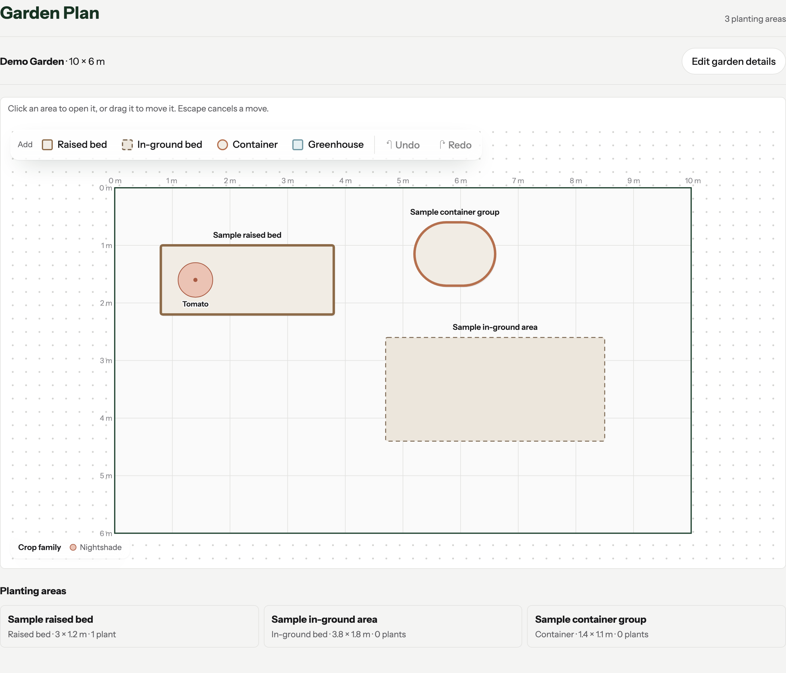
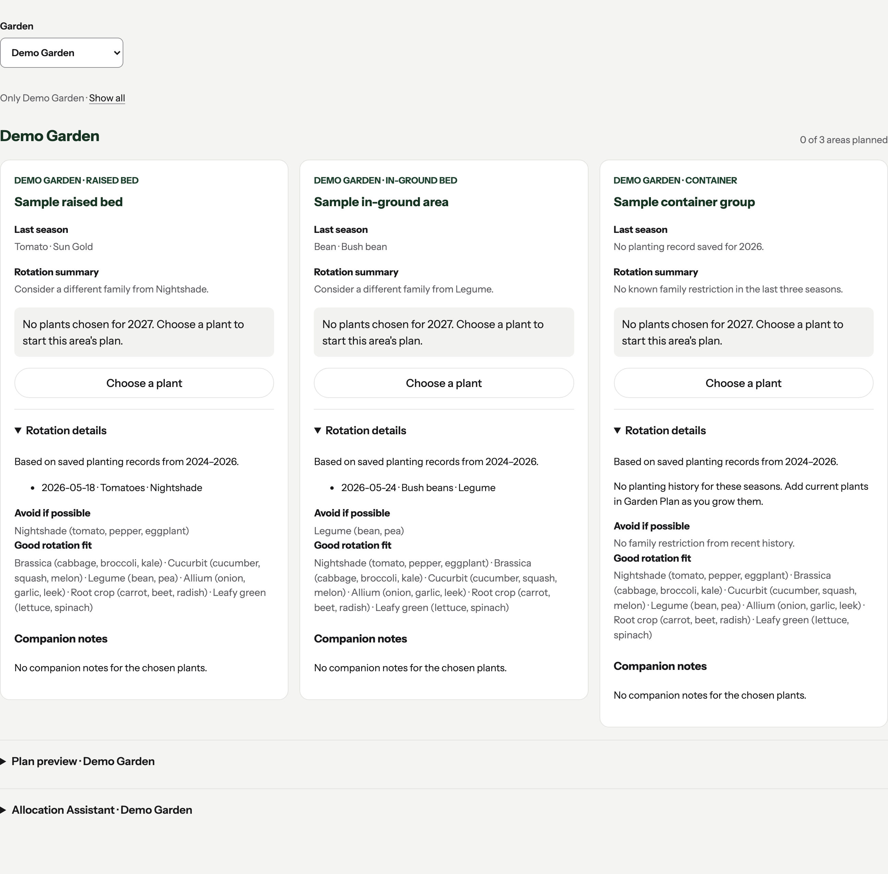
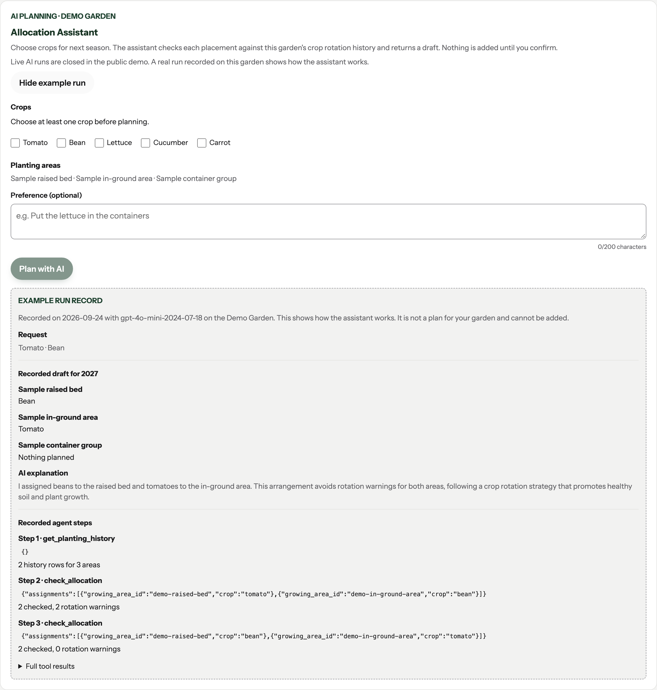

# Garden Manager

A full-stack garden operations and seasonal-planning application. It helps a
gardener organize multiple locations, visualize planting areas, record care,
plan the next season, and ask source-grounded plant questions.

**[▶ Open the live demo](https://garden-manager-demo.vercel.app)** — no install, no account. Select **Open app**, then **Load demo garden** to explore a populated workspace.

`Next.js` `React` `TypeScript` `FastAPI` `Pydantic` `PostgreSQL` `SQLAlchemy` `Alembic` `pgvector` `OpenAI API` `Docker Compose` `GitHub Actions` `pytest` `Vitest` `Playwright`

## Screenshots

**Garden plan** — one canvas on a real metric grid. Each area type button drops a standard-size bed; areas drag and resize in place, opening an area zooms the same canvas to place plants, and every edit saves at once with Undo and Redo. A new garden walks through four guided steps: garden size, planting areas, plants, and Ready.



**Next Season** — area plans first, with expandable rotation history and companion sources.



**Allocation Assistant** — the recorded run shown in the public demo. The agent reads the planting history, checks a first plan (2 rotation warnings), revises it, and returns a draft with none. Nothing is added until the gardener confirms.



## What It Demonstrates

- **Garden operations:** multiple gardens, raised beds, in-ground beds,
  containers, and greenhouses on one metric plan canvas, with direct
  placement, autosave, undo, and a guided first-run setup.
- **Current records:** plants, care history, recurring care tasks, and
  reviewable plant-health records.
- **Seasonal planning:** crop-family rotation guidance by growing area and a
  separate next-season plan with companion-planting notes.
- **Applied AI:** Chinese and English care-note extraction, local RAG-backed
  Plant Guide answers, visible citations, and user review before records
  are saved.
- **Tool-calling agent:** an Allocation Assistant that calls two read-only
  tools, revises its plan from rotation feedback, and returns a draft the
  gardener confirms. It has a hand-written loop, a byte-bounded cost per run,
  and a paid evaluation against an enumerating baseline. The evaluation found
  valid drafts in 10 of 10 cases, all automatic checks passed in 7 of 10, and
  some explanations were inaccurate. See [the agent write-up](docs/agent.md).
- **Reliable persistence:** automatic PostgreSQL sync, revision-checked saves,
  and explicit conflict resolution when another tab saves first.
- **Full-stack delivery:** Next.js, FastAPI, PostgreSQL, Alembic, pgvector,
  Docker Compose, GitHub Actions, Vitest, pytest, and Playwright.

## Five-Minute Demo

The frontend updates described here are local changes and have not been deployed to the hosted demo. Locally, `/` is the landing page and `/gardens` is the app.

### Hosted demo (fastest)

Open the [live demo](https://garden-manager-demo.vercel.app), select **Open app**, then **Load demo garden**,
then walk through steps 4-6 below. Garden, Care, and Next Season are available
online; AI and photo workflows are shown as previews and run in the local app.
In **Next Season**, the Allocation Assistant does not run live online; it
offers a labelled recording of one real evaluation run under the expandable **Allocation Assistant**.
AI Garden Note stays directly available on the Gardens page; the hosted build keeps its assisted-entry restrictions.
The API sleeps on the free tier, so the first request can take about a minute.

### Local (full feature set, including AI)

1. Start the API and database with `docker compose up --build`.
2. In another terminal, run `npm install`, then start the web app with `npm run dev`.
3. Open `http://localhost:3000/gardens` and select **Load demo garden**. The landing page is at `http://localhost:3000`.
4. Select the **Demo Garden** card. Open an area to zoom the plan into it and
   place plants, drag an area to move it, and use **Undo** to reverse a change.
   **Add garden** starts the four-step guided setup on the same canvas.
5. Return to **Gardens** and open **Next Season**. Choose plants for each area. Expand **Rotation details** for history and companion sources,
   or **Allocation Assistant** to review an AI draft or the recorded demo run.
6. Open **Care** to create a task or record a completed care event.
7. After completing [Enable local AI features](#enable-local-ai-features), open
   **Plant Guide** to ask a Chinese or English question and inspect the cited source cards.

The demo uses generic data and can be loaded repeatedly. It replaces the
gardens saved in the current browser workspace.

## Architecture

```text
Next.js + React + TypeScript
        |
        | typed workspace requests
        v
FastAPI + Pydantic
        |
        v
PostgreSQL + SQLAlchemy + Alembic + pgvector
        |
        +-- deterministic crop-rotation service
        +-- local AI extraction and plant-knowledge retrieval
        +-- Allocation Assistant: hand-written tool-calling loop
            over the OpenAI API, two read-only tools, server re-check
```

The frontend renders measured growing-area layouts with React-Konva. Garden
data is created in the browser and synced to PostgreSQL automatically the first
time it changes; from then on PostgreSQL is the workspace's write source. Every
save carries a workspace revision, so a stale tab gets an HTTP 409 and a choice
to reload or overwrite instead of silently losing the other tab's work. The full data model
and trade-offs are documented in [Technical Architecture](docs/technical-architecture.md)
and the [Architecture Decision Records](docs/decisions/README.md).

## Local Setup

### Requirements

- Node.js 20 or later
- Docker Desktop
- Optional for local AI: [Ollama](https://ollama.com/)

### Start the application

```bash
docker compose up --build
```

In a separate terminal:

```bash
npm install
npm run dev
```

Open `http://localhost:3000` for the landing page and `http://localhost:3000/gardens` for the app. The API documentation is available at
`http://localhost:8000/docs`.

### Enable local AI features

The local provider uses Ollama. Download the two models once:

```bash
ollama pull qwen3:4b
ollama pull embeddinggemma
```

Keep Ollama running and restart Docker Compose after downloading the models.
Care events and plant-health observations can also be entered manually. Plant Guide answers require the configured embedding and answer models to be available.

AI Garden Note has its own provider setting, `CARE_NOTE_AI_PROVIDER` (default
`ollama`), so switching it does not change Plant Doctor
([ADR-0058](docs/decisions/0058-classify-care-notes-before-filling-a-draft.md)).

In the local app, the homepage note can produce up to six review drafts across
gardens. Review each action, date and target, edit or exclude individual rows,
and save the selection together. Manual entry remains available. Drafts stay
in the current tab while navigating; keep the tab open until saving finishes.
Failed synchronization retries the same records. The public demo retains its
single-event restrictions. Batch provider compatibility and extraction quality
still need real-model evaluation; current automated checks use mocks
([ADR-0068](docs/decisions/0068-extract-bounded-workspace-care-note-batches.md)).

The Allocation Assistant uses the OpenAI API whatever `AI_PROVIDER` is set to.
Put `OPENAI_API_KEY` in the API's environment to run it live; without a key it
reports that the planner is unavailable. Cost limits and the evaluation are in
[the agent write-up](docs/agent.md).

## Verification

Frontend:

```bash
npm run lint
npm run typecheck
npm test
npm run build
```

End to end (real Chromium against the real Next.js app, FastAPI, and a fresh
migrated SQLite database on ports 3100/8100; first run needs
`npx playwright install chromium`):

```bash
npm run test:e2e
```

Backend (SQLite by default; point `TEST_DATABASE_URL` at a PostgreSQL database
to run the same suite plus the PostgreSQL-only concurrency tests):

```bash
cd backend
pytest
TEST_DATABASE_URL=postgresql+psycopg://garden@localhost:5433/garden_planner_test pytest
```

GitHub Actions runs frontend lint, type checks, tests, and build; the backend
suite twice (SQLite for speed, then a real PostgreSQL service so the
optimistic-locking `UPDATE` is verified on the production database); one
Playwright end-to-end flow (create a garden, save an edit, plan next season,
reload, and find both served back by the API); and a Docker health check on
pull requests and pushes to `main`.

## Product Boundaries

- The application supports a single-user workspace with PostgreSQL persistence.
  Account authentication and authorization remain outside the current release;
  use generic data in the public demo.
- The portfolio demo deploys Garden, Care, and Season Planner workflows on
  Vercel, Render, and Supabase. It uses generic data and keeps AI and photo
  features in the local app.
- The Allocation Assistant is implemented and runs live in the local app with
  an OpenAI key. The public demo keeps live runs closed and shows a recorded
  example instead, because the evaluation found misleading explanations
  ([ADR-0057](docs/decisions/0057-keep-live-allocation-runs-closed-after-evaluation.md)).
- Plant Guide uses a small curated source set with visible citations. It
  provides educational guidance and requests more detail when evidence is weak.
- Map-backed yard initialization and yard-wide sun analysis remain deferred
  research work. The operational garden workflow is the active product.

## Additional Documentation

- [Product Brief](docs/product-brief.md)
- [Technical Architecture](docs/technical-architecture.md)
- [Project Strategy](docs/project-strategy.md)
- [AI and RAG Design](docs/ai-rag-agent-design.md)
- [Allocation Assistant: A Small Tool-Calling Agent](docs/agent.md)
- [Portfolio Demo Deployment](docs/portfolio-demo-deployment.md)
- [Architecture Decision Records](docs/decisions/README.md)
